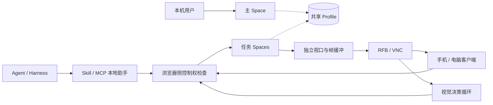

# AgenticBrowser：需求、技术架构与分阶段实施计划

> 2026-10-23 本轮补充：用户已授权模型服务商设置（预设 URL、多个 Custom、接口动态获取模型、实际调用后绿点）及参考 jev-ultrafast 的 DOM 决策任务。真实 API 验收后补。详见 [模型接入与决策操控](docs/模型接入与决策操控.md)。以下历史“模型延后”描述保留为当时范围，不代表本轮继续禁用；VNC 图像推理验收仍未完成。

版本：v0.1 讨论稿  
日期：2026-10-21（Asia/Shanghai）  
状态：仅完成方案整理，尚未编码、安装依赖、构建浏览器或实测性能。本文中的性能数值是建议验收目标，不是已实现指标。后续实施需另行获得开始指令。

2026-10-21 补充：用户随后已授权第一阶段实施，实际进展见《第一阶段实施记录.md》。本次新增 R10“锁屏持续运行”，并补充架构及 A09 验收；以上状态保留为初版历史说明。当前仍先完成浏览器与 Space，新增锁屏链路随第一阶段 VNC 接入在 Mac 上验证，Windows/Linux 留在原定跨平台阶段。

2026-10-22 补充：用户明确要求第一阶段就在同一个真实浏览器窗口内切换三个 Space，交互参考 Ego。Space 是包含多个标签页、记住当前标签和控制权的独立工作区；未锁屏时即可切换、观察、接管和交还。此要求替换初版“三窗口承载 Space”的安排；锁屏只延续同一工作区的后台任务，不改变其身份。以下相应更新为需求与验收标准，不代表这些能力已实现。

2026-10-22 界面状态补充：依据 Ego 实际体验，Agent 控制使用带轻微呼吸动效的蓝色 Lomo 渐变蒙版；真实 VNC 观看连接建立后显示绿色，远端成功取得控制权后显示红色。颜色优先级为远程控制红色、VNC 已连接绿色、Agent 控制蓝色；交还或断开后按实际连接与控制权回退，不能在仅点击连接或申请接管时提前变色。主 Space 仍仅人操作且不开放 VNC。本轮界面改造只实现已有 Agent 控制链路的蓝色动效，绿色／红色随原定 VNC 接入实施，不扩大当前范围。

2026-10-22 最新执行范围：用户随后授权继续第一阶段的 MCP、单路 VNC、绿色观看／红色远程接管及交还，并验证当前 Mac 锁屏后的画面与操作。模型明确延后，A07/A08 暂不执行；不扩展第二、第三阶段。当前实现使用单 Space stdio MCP、B 专用 1280×720 RFB 流（最高 15 FPS）、独立 LibVNC helper 与 noVNC，按原 WebContents 比例留边并反算输入坐标。VNC 仅覆盖网页视口，不含本机浏览器工具栏、蒙版与独立原生弹窗；目标标签、视口尺寸或浏览器缩放改变会退回观看，需明确重新接管，pinch 视觉缩放暂拒绝远程输入。前文“仅实现蓝色”保留为上一轮历史状态。本机 MCP、VNC 交接、100%／125% 坐标、静态像素一致性与最终构建真实 Mac 锁屏 62.315 秒已实测通过；局域网 iPhone/noVNC 的三轮交接、重连仅观看及 20 次点击粗测也已通过（P50 115 ms、P95 143 ms、最大 144 ms）。此结论限于当前 Mac 与同 Wi-Fi 手机、简单验收页面；本轮未重复手机与 Mac 锁屏的组合测试，不据此扩大为 A05/A06/A09 所有条件全部通过。证据见《第一阶段实施记录.md》。

## 1. 项目目标与执行原则

做一个面向人与 Agent/Harness 协作的桌面浏览器：保留日常浏览和 Chrome 扩展能力；多个 Space 共享登录态，各自独立操作；任务 Space 可输出 VNC 画面，并支持人、Harness 和视觉决策运行时之间交接控制权。

遵守三个约束：**不把项目搞复杂、不做过度测试、不做过度编码。**

- 保留完整产品目标，按阶段交付；不要求 PoC 一次实现全部能力。
- 采用完整 Chromium 分支，尽量复用上游界面、存储、渲染和扩展实现；不修改 Blink/V8 来实现原本可在浏览器层完成的功能。
- PoC 在同一个真实浏览器窗口内提供三个 Space 和最小原生切换、接管/交还控件；每个 Space 有自己的标签页集合，不先设计完整侧边栏、主题或复杂工作台。
- 功能集中在浏览器改动和一套本地助手代码中，不拆微服务，不引入独立数据库、消息队列或调度平台。
- 一期只接一个真实决策服务；第二个服务确有需求后再提炼适配层，不预先实现所有模型。
- 检查聚焦登录态、操作范围、控制权交接、画面与输入、真实模型闭环；不设固定测试覆盖率，不建设通用评测平台。
- 每个实现项必须能对应本文需求或验收项；暂时没有使用场景的抽象与功能不进入开发。

## 2. 完整产品需求

| 编号 | 需求 | 行为与边界 |
|---|---|---|
| R01 | Chromium 与 Chrome 兼容 | 采用 Chromium/Blink/V8，保留完整浏览器和当前 Chrome 扩展体系，跟随上游稳定版及安全更新。网页兼容、扩展兼容和 Google 专有服务分别验证，不承诺与 Google Chrome 所有服务完全相同。 |
| R02 | 跨平台 | 最终支持 Windows、macOS、Linux，各自包含 x64、arm64 原生构建。Linux 覆盖 Wayland/X11；手机作为远程客户端，本项目不开发移动端浏览器内核。 |
| R03 | 多 Space | 同一个真实浏览器窗口内有一个主 Space 和多个任务 Space；Space 是独立工作区，每个 Space 可包含多个标签页，并记住自己的当前标签。切换 Space 不重建页面，不改变其他 Space 的任务、选中标签页或控制权。参考 Ego 的工作区切换、观察、执行、接管和结束流程。 |
| R04 | 共享浏览器状态 | 各 Space 使用同一 Profile，沿用同一浏览器的 Cookie、同源持久化存储、登录态、权限及扩展规则；不通过复制 Cookie 或多个实例同时读写 Profile 实现共享。 |
| R05 | Skill + MCP 接入 | Harness 可发现被授权的任务 Space，创建任务、读取页面、导航、点击、键盘输入、填写、滚动、管理标签页、上传下载、处理任务内弹窗、启停画面流和决策循环。全局配置、账号和凭据管理不随任务控制权自动开放。 |
| R06 | 主 Space 仅供人操作 | Agent 接口不能取得主 Space 控制权，也不能直接读取其页面快照或画面。需要浏览器侧强制校验，不能只写进 Skill。共享账号和站点数据仍可能使主 Space 受到间接影响。 |
| R07 | Space 级 VNC | 可为指定任务 Space 开启独立 RFB/VNC 会话，传递渲染后画面、接收输入；无需修改被访问网站。客户端可为 Agent/Harness、手机或电脑。 |
| R08 | 控制权交接 | 不同 Space 可同时被不同操作者控制；同一 Space 同时只有一个操作方，可有多个观察者。正常未锁屏时即可切换和观察任务 Space，观察不夺取控制权；人工接管使旧 lease/代次失效，交还后由原 Harness 用 resume 领取新 lease/代次，再携带新控制权 observe 当前页面，完成观察后才允许继续动作。 |
| R09 | 多模态概率决策 | 设置中可配置云端 API 或本地服务；支持以图像/页面状态为输入、以选项概率等结果为输出的决策模型，形成观察—决策—执行—验证闭环。具体输入、定位、生成能力由适配器声明。 |
| R10 | 锁屏持续运行 | Windows、macOS、Linux 在锁屏或未锁屏时，已启用的任务 Space 都有独立于桌面显示的虚拟渲染视口，持续生成网页画面；VNC 可观看、连接及控制，本机 Agent/Harness 可继续导航、点击、输入和滚动。锁屏只延续同一工作区的后台任务，不另建 Space、标签页或浏览器实例，不改变归属、共享 Profile 或控制权。系统需保持运行、用户会话未注销。 |

### 2.1 共享与隔离的准确含义

- Cookie、LocalStorage、IndexedDB 等沿用 Chromium 的域、来源和存储分区规则；“共享”不表示跨网站共享数据或取消浏览器隔离。
- sessionStorage 保持正常的标签页级语义，不强行在所有 Space 之间同步。
- Space 隔离的是任务页面的直接操作权，不是账号、服务端数据或全部浏览器资源。
- Agent 在其他 Space 退出登录、修改同源存储或服务端数据，可能影响主 Space。若未来要求完全互不影响，必须重新讨论独立 Profile，这会改变共享登录态要求。
- 主 Space 保护针对本浏览器提供的接口。拥有任意操作系统权限的 Harness，或被授予全局权限的扩展，不能仅靠 Space 协议约束。PoC 使用受信任本地客户端；后续审核扩展与全局调试接口的绕行路径。

### 2.2 目标场景

| 场景 | 浏览器承担的能力 | 额外边界 |
|---|---|---|
| 网页问答、表单填写 | 观察页面、选择答案、输入已确定内容、校验结果 | 自由文本由生成模型、模板或 Harness 提供。 |
| 五子棋、象棋 | 识别棋盘、执行合法落子、检查回合状态 | 操作速度和棋力分别评价；必要时接专用棋类引擎。 |
| Web 游戏 | 输出 Canvas/WebGL 画面，执行按键、点击与持续输入 | 动作游戏的时延需实测；不能凭模型榜单保证可玩。 |
| 远程人工协助 | 观看任务、接管、处理页面、交还 | 只对获得授权的 Space 开放，不默认暴露整台电脑。 |

## 3. 技术架构

### 3.1 技术基线

| 部分 | 选择 | 控制复杂度的方法 |
|---|---|---|
| 浏览器 | 完整 Chromium 浏览器分支 | 保留上游网页、扩展和桌面能力；新增功能尽量集中在少量浏览器层模块。 |
| Space | 同一 Profile、同一浏览器窗口下的独立工作区状态 | 第一期即实现三个 Space 的原生切换；分别保存标签页集合、当前标签和控制权，复用 Chromium 的标签展示能力，不把一个 tab 当作一个 Space。 |
| 原生改动 | 沿用 Chromium 的 C++ 和构建体系 | 只实现 Space 归属、操作检查、输入路由与画面输出等必要能力。 |
| 设置 | 复用 Chromium WebUI | 从一页必要配置开始，不额外引入桌面 UI 框架。 |
| Skill/MCP/模型接入 | 一套 TypeScript 本地助手代码 | 复用同一命令接口；不分别建设 CLI、HTTP、gRPC 等多套业务协议。 |
| VNC | 成熟 RFB 实现 + noVNC 客户端 | 实施时先核对许可和跨平台适配；不自研完整编码协议，不在一期增加 WebRTC。 |

选择完整 Chromium 会带来源码体积、构建和版本维护成本。这是扩展兼容要求的代价；项目简化应减少自有改动，不通过换成不满足需求的内核省略这部分成本。

Ego 的公开 Skill/连接层可以作为接口设计参考；现有公开资料不能据此认定能直接获得完整浏览器源码。Electron 官方仅承诺部分 Chrome 扩展 API，不作为本项目完整扩展兼容的基线。

图中的框是职责划分，不代表分别部署一个服务。MCP 适配与视觉决策循环属于同一套助手代码；控制权检查留在浏览器内，外部组件不能跳过。

### 3.2 Space、输入与控制权

Space 最少保存：独立标识、类型（主/任务）、所属标签页集合、当前标签、当前操作者、控制权代次。不同 Space 共用 Profile，但不能借此互相枚举或操作未授权标签页。标签页或内核展示分组不能代替 Space 身份与授权检查。

未锁屏时，通过浏览器原生控件在同一窗口切换 Space、查看当前操作者并接管/交还。切换只改变本机正在展示的工作区；观察不取得输入权，也不暂停其他 Space 的任务。

每条动作绑定 Space、标签页和控制权代次，浏览器在真正派发动作时检查，而不只在连接建立时检查。主 Space 不发放 Agent 操作凭证；PoC 也不为主 Space 开放 VNC。

控制权只需要几个明确行为：

1. Harness 取得任务 Space 控制权后，可以执行该 Space 内的动作；其他客户端只能观察。
2. 人接管时更新操作者和代次，使旧 lease 失效，停止旧循环，拒绝旧代次排队动作及迟到的模型结果，释放仍按住的键和鼠标按钮。
3. 人交还后进入可恢复状态；原 Harness 通过 resume 领取新 lease/代次，再携带新控制权 observe 当前页面；重新观察完成前禁止动作，不能直接复用旧动作。旁观者的只读 observe 不能替原 Harness 解除这个门槛。
4. 控制连接断开后停止派发后续动作；重新连接需要重新检查归属，不自动复用旧动作。
5. 已经发送到网站的请求不能通过交接撤回；恢复任务时必须观察实际结果，避免重复提交。

输入直接路由到目标页面/渲染视图，不移动系统鼠标，不改变用户正在查看的 Space。切换用户当前可见 Space 不等于切换其他 Space 的控制权。

不向 Harness 暴露无限制的浏览器级 CDP 端口。以后确需低层能力时，仍经相同范围校验。Space 内弹窗继承其归属；涉及浏览器全局设置或主 Space 的操作不自动继承任务授权。

### 3.3 VNC 与画面

每个启用流的 Space 输出一个选定标签页的视口，来源为浏览器合成后的帧缓冲；一个 Space 有多个标签页时切换流目标，不默认同时编码全部页面。

- 覆盖视口内的 HTML、Canvas、WebGL 与跨域 iframe；在后台、遮挡、最小化场景下验证持续更新。
- “完整页面画面”指视口内完整合成结果，长页面通过滚动访问；不把全页长截图作为实时视频。
- 画面记录视口尺寸、缩放及坐标映射版本；调整尺寸后，旧坐标动作失效。
- VNC 输入与 MCP 输入经过同一个控制权检查；VNC 连接成功不等于获得操作权。
- 一期最多开启一路流，限制分辨率和帧率；后续按实际并发需求增加配额与后台调度。
- 文件选择器、浏览器权限提示、扩展弹窗不是普通网页帧，完整支持放到第二阶段处理，不声称单纯捕获 WebContents 已覆盖这些界面。

远程服务默认关闭。PoC 使用本机或可信局域网，启用一次性会话凭证，只访问指定任务 Space；不开放公网，不建立云中继。正式跨网络访问再补齐加密连接、配对与连接撤销。

#### 3.3.1 锁屏与虚拟渲染视口（新增 R10）

每个启用后台任务的 Space 保留一个固定大小的浏览器内渲染目标及帧缓冲。同一浏览器窗口中的 Space 展示、VNC 编码和 Agent 观察读取同一份合成结果；操作直接路由到对应 WebContents。锁屏是这些工作区继续在后台运行的状态，解锁后仍回到相同 Space、标签页与控制权。锁屏、窗口遮挡、最小化和息屏不能使这一任务链路依赖桌面截图或系统前台焦点，也不以模拟系统鼠标键盘来实现后台控制。

- 复用 Chromium 的合成、页面捕获和隐藏页面持续渲染机制，先验证现有渲染目标是否能持续产帧；必要时才补充平台离屏渲染承载。仅关闭后台节流标志不算实现。虚拟图面是浏览器内部视口，不要求先引入虚拟机、完整远程桌面或虚拟显示器驱动。
- 在任务/VNC 活跃期间管理页面可见性、合成帧调度、页面冻结和丢弃，保留 Canvas/WebGL、iframe 与网页交互。页面的逻辑可见性不直接等同于物理屏幕是否亮起。停止任务后释放保持渲染所需资源。
- 后台任务模式提供明确的“运行期间保持系统唤醒”选项，使用操作系统支持的临时电源请求，允许锁屏和息屏；结束时释放。它不能保证强制休眠、合盖休眠、休眠到磁盘、注销、关机或管理策略下仍可执行。恢复后重新观察，旧帧和过期动作失效。
- VNC 在锁屏前已连接和锁屏后新连接均应可用；输入仍经过同一 Space/控制代次检查，接管交还规则不变。本机 Agent/Harness 也须是锁屏后仍在运行的进程。
- 主 Space 的保护继续有效，PoC 不为其开放 Agent 读取/控制或 VNC。VNC 输出任务网页画面，不暴露系统锁屏、登录界面或其他应用；不执行系统解锁。
- macOS 先验证窗口服务器、后台调度和 GPU 在锁屏时的实际行为；Windows 验证桌面锁定后的渲染与输入路由；Linux 分别验证 X11/Wayland。硬件或系统限制若需要软件渲染回退，应单独记录性能，不能直接声称达到原 GPU 指标。

当前固定 Chromium 源码的 `WebContents::IncrementCapturerCount` 明确提供隐藏/遮挡时持续产帧、逻辑可见性和保持唤醒参数，可作为实现入口；这不等于已经证明三个系统锁屏时可用。锁屏需实机验收，不能用普通后台窗口或 headless 截图代替。

### 3.4 决策运行时

Harness 负责目标、候选动作规则、停止条件和运行预算；常驻运行时负责执行短循环。MCP 用于启动、停止、查询和交接，不承担每帧一次的 Harness 推理调用。

流程：VNC 解码 → 获取最新帧/关注区域 → 构造状态与候选动作 → 请求模型 → 校验结果 → 执行动作 → 观察结果。

本机后续可直接使用同源帧缓冲减少编解码开销，但第一阶段必须验证真实 VNC 解码路径，不能用普通截图替代 VNC 后宣称该链路已完成。

最小接口约定：

| 内容 | 约定 |
|---|---|
| 输入 | 任务说明、当前图像/可用状态、候选动作 ID、当前帧时间、视口与页面版本。 |
| 输出 | 被选动作 ID、可用的选项概率，以及模型实际提供的其他字段；保留模型和版本。 |
| 定位 | 可使用 DOM/可访问性信息、已知网格坐标或模型定位能力，不要求所有模型都有 Box。 |
| 不确定性 | 允许等待、重新观察、交还 Harness；不伪造模型没有返回的置信度。 |
| 执行检查 | 动作在候选集合内，控制权有效，页面/视口版本未失效，画面未超过有效期。 |

选项概率与答案置信度保留原有含义，不强行合并。类型正确不代表动作正确；目标存在性、坐标边界、合法动作仍要检查。对动态内容，版本与有效期检查也不是通用语义正确性保证。

一期最多一个推理请求在途，不积压旧帧，不自动重试过期动作；按目标状态变化或限频调度。显示帧率、模型调用频率和输入频率分别控制。

最小设置项：服务地址、密钥、模型版本、必要请求头、请求超时、最大调用频率、画面有效期。PoC 密钥只保存在会话内存中，不落项目文件或日志；需要持久化时再接操作系统凭据存储。

模型候选包括 TypeSafe Jev、Cloudflare Clef、Perplexity Decider、AutoTrust JEV 等。它们是待验证候选，不代表已经兼容。Jev 官方已有实验性 Images/Box 能力；实际服务、版本和图像权限在接入时再次核对。首选一个已能获得访问权限的图像模型，不同时部署多个本地大模型。

## 4. 第一阶段 PoC

### 4.1 要回答的问题

**能否在共享登录态的同一个真实浏览器窗口内切换独立 Space，让人和两个任务并行操作，并在一个任务 Space 上完成真实 VNC 传输、接管交还及真实模型选点闭环？**

当前工作机器已核验为 macOS arm64。PoC 只以这一平台验收；不能将其结果表述为六个平台均已支持。

### 4.2 范围

| 项目 | 一期实现范围 |
|---|---|
| 浏览器 | 一个固定稳定版 Chromium 基线，一个运行实例，一个测试 Profile。保留正常多进程架构，不要求一个 Space 对应一个独立进程。 |
| Space | 同一个真实浏览器窗口内固定三个工作区：主 Space、任务 A、任务 B；各自支持多个标签页、记住当前标签和控制权，提供最小原生切换、观察、接管/交还控件，不做新工作台。 |
| Agent | 一份最小 Skill、一个 MCP 接入路径。用两个独立客户端会话模拟不同 Harness，不要求接遍所有 Harness 品牌。 |
| 页面操作 | 创建/绑定任务、导航、观察、点击、输入、滚动、停止；支持 Space 内多标签和当前标签保持，其余完整操作在第二阶段补齐。 |
| 并行任务 | 主 Space 人工输入；A 执行普通网页任务；B 输出画面并支持远程接管。决策循环按最新指令延后。 |
| VNC | B 的一路标准 RFB 流；一个 noVNC 客户端在局域网手机或另一台电脑上观看与输入。 |
| 锁屏运行 | 在当前 Mac 上验证 B 的虚拟视口与 VNC、A 的本机客户端操作在锁屏时持续可用；复用已有页面和控制接口，不在一期同时适配 Windows/Linux。 |
| 模型 | 原计划为一个真实支持图像输入的服务；本轮按用户指令延后，不配置、不调用。 |
| 设置 | 当前以最少启动参数和私有连接文件接入 MCP/VNC；模型设置随模型接入，不做配置市场或复杂账号系统。 |
| 演示 | 一个受控本地测试页面，包含表单、可变化的 Canvas 网格、小型 WebGL 动画及简单 iframe；用可见目标选点验证画面—决策—点击闭环。 |
| 结果 | 一份简短操作说明与验收记录，记录平台、版本、测量条件、结果和已知限制。 |

测试页面仅作为验证工具，在获准开始编码后才创建。模型必须根据当前图像选择目标；已知页面状态可用于判断结果，不能代替模型做选择后冒充模型能力。

### 4.3 明确不做

- 六平台同时适配、安装包、自动更新和签名发布。
- 完整五子棋/象棋 AI、复杂动作游戏、通用游戏控制框架。
- 多模型自动路由、训练、微调、本地 27B 部署和排行榜。
- 公网穿透、云中继、多租户、组织权限、远程设备管理。
- 全部标签页同时流式输出、复杂资源调度和性能优化框架。
- 任意扩展的完整兼容认证、全套浏览器权限/设备弹窗远程操作。
- 新建浏览器 UI 体系、Skill 市场、工作流编辑器、长期记忆系统。

### 4.4 执行顺序

1. 取得一个稳定版 Chromium 的可运行基线，确认原有网页与扩展能力可用。
2. 在同一窗口建立三个 Space 的标签归属和控制权检查，先验证共享状态、未锁屏时的切换/观察/接管/交还、并行输入与主 Space 限制。
3. 接入最小 Skill/MCP，保持所有动作经过相同检查。
4. 接入一路 VNC、远端输入与接管交还，解决后台渲染问题。
   同一步验证 Mac 锁屏时的虚拟渲染视口、本机 Agent 操作和远端连接；不以“窗口最小化正常”代替锁屏结果。
5. 接入一个真实图像决策服务，完成受控页面选点循环；此步按最新用户指令延后，等待后续明确继续。
6. 执行下表一次集中验收，记录结果，决定下一阶段。

如果第 2 步不能做到操作范围正确，第 4 步不能持续输出后台画面，先处理这两个问题，不用 UI 或模型功能掩盖它们。

### 4.5 验收标准

以下是 PoC 建议标准；性能项需注明机器、模型、网络、分辨率与时间点，不能作为生产 SLA。

| 编号 | 对应需求 | 验收操作 | 通过标准 |
|---|---|---|---|
| A01 | R01、R02、R03 | 在当前 Mac 的同一个真实浏览器窗口内打开三个 Space，每个 Space 打开两个标签，选中不同标签后往返切换；人工试用一个常用 MV3 扩展 | 窗口保持同一个；Space 身份、成员标签和各自当前标签保留，切换不重建页面；扩展能完成其基本功能。仅代表一个平台和一个扩展样例通过。 |
| A02 | R04 | 在受控站点建立会话，跨 Space 读取 Cookie/持久化存储，再改变登录状态 | 同源共享状态符合普通同 Profile 标签页行为；sessionStorage 保持正常标签页语义；无 Cookie 复制机制。 |
| A03 | R03、R05、R08 | 未锁屏时以主 Space 人工输入为主，两个独立客户端同时操作 A、B，运行约 60 秒；期间短暂切换观察 A/B，再回到主 Space | 无错投输入、抢系统鼠标或擅自切换当前 Space；每个客户端只操作自己的 Space。切换观察不夺权、不暂停任务，各 Space 选中标签和输入状态保留。 |
| A04 | R06 | 用 Agent 入口尝试访问主 Space、指定未授权标签页、绕过归属执行动作 | 全部被浏览器侧拒绝；不返回主 Space 页面内容；没有可直接绕过检查的全局调试入口。 |
| A05 | R07 | B 以 1280×720、最高 15 FPS 输出；检查 Canvas/WebGL、iframe，分别切后台及最小化约 30 秒 | 画面持续更新，不持续黑屏或冻结；连续动画场景有效更新达到 10 FPS。手机或另一台电脑实际连通；仅本机连通不能记作跨设备通过。 |
| A06 | R07、R08 | 先在未锁屏本机完成一次观察→接管→交还，再做远端人工接管并交还共 3 轮；包含一个接管后才到达的旧动作，以及断开重连 | 观察不夺权；接管后旧 lease/动作拒绝执行、旧循环暂停、无按键粘连；交还后原 Harness 领取新控制权并携带该控制权重新 observe，再恢复动作。局域网人工点击到可见响应的粗测 P95 ≤ 200 ms，取 20 次操作。本机交接通过不能代替远端验收。 |
| A07 | R09 | 真实图像服务在 Canvas 网格中完成 20 轮目标选点；另触发一次超时/过期结果 | 正确选点至少 18/20；所有输出都受候选集合、控制权和有效期检查；超时/过期结果不执行。画面采样到动作派发的粗测 P95 ≤ 1,000 ms；默认动作有效期 1,500 ms。 |
| A08 | R08、R09 | 在决策请求途中人工接管，再交还；之后达到任务停止条件 | 迟到的模型结果不能执行；交还后基于新状态继续；完成后停止请求和输入。 |
| A09 | R07、R08、R10 | 在 Mac 上运行现有 A/B 任务，人工锁屏约 60 秒且系统保持唤醒；本机客户端继续操作 A，另一设备通过 VNC 查看并操作 B；包含一次锁屏后重新连接，最后人工解锁 | 锁屏期间 B 的 Canvas/WebGL/iframe 持续更新，沿用 A05 的分辨率和帧率目标；A 的点击/输入/导航有实际页面结果，B 的远端点击/输入有效；控制权及主 Space 限制仍生效。解锁后显示相同任务与登录状态，无需重建 Profile、重登或切换另一个浏览器实例。不另建压力或长稳测试。 |

A06 的延迟包含传输、输入和页面响应；A07 包含画面处理、模型网络往返、推理与派发，不是单独引用供应商推理耗时。超时和错误计入 20 轮，不剔除后只汇报成功样本；无法完成的操作单独记失败，不伪造其延迟。20 次样本只用于 PoC 粗测，不证明稳定尾延迟、泛化准确率或游戏水平。

完成判定：A01—A09 均通过，才标记“第一阶段 PoC 完成”。功能正确但性能不达标时，记录为“功能链路通过、性能目标未达成”；不得合并成全部通过。缺少模型访问权限、远程设备或构建条件时，记录对应项“待验证”。模拟输出只能辅助调试，不能代替真实模型验收。

### 4.6 测试做到什么程度

- 主要复用同一个测试页面和同一份验收清单，不为每项另建独立测试工程。
- 只为主 Space 拒绝访问、错误归属、旧控制权动作被拒绝等关键判定保留少量自动化检查。
- 并行输入、VNC、扩展和远端交接以一次人工冒烟验收为主；性能取上述有限样本，不先做压力、长稳或全面兼容测试。
- 修改影响哪项就重跑哪项；修复共享底层能力时才连带重跑相关项。
- 不做全量 Chromium 测试、不设覆盖率指标、不反复运行无关检查；不得通过关闭关键检查来满足“不做过度测试”。

## 5. 分阶段实施计划

| 阶段 | 目标与主要工作 | 出口标准 |
|---|---|---|
| 第一阶段：核心 PoC | 按第 4 节，在 macOS arm64 的同一浏览器窗口内完成三个 Space、多标签与共享 Profile、正常状态下的切换和交接、最小 Skill/MCP、一路 VNC、锁屏持续运行和一个真实模型闭环 | A01—A09 通过；保留短验收记录和实际限制；不附带未验证的跨平台声明。 |
| 第二阶段：可日常试用 | 持久化 Space/标签页；按实际使用补齐上传下载、弹窗与任务恢复；完善必要设置和密钥存储；核查扩展/低层接口绕行；支持可靠的任务 Space 远端访问；选择一个真实表单或棋类网页完成任务 | 一项真实网页任务可端到端完成；人可随时接管和交还；密钥不明文落盘；已声明支持的浏览器界面有明确处理路径。 |
| 第三阶段：完整平台与发布 | 完成六个平台/架构构建，处理 Linux Wayland/X11 差异；提供安装、签名及更新方案；验证当前 Chrome 扩展机制；建立上游更新流程；按实际需求加入第二个模型服务 | 六个目标分别完成启动、网页/扩展基本操作、锁屏下虚拟视口、VNC 和本机 Agent 操作及交接的实机冒烟；Linux 分别覆盖 X11/Wayland；记录不支持项，具备受控发布条件。 |

不以未经验证的团队规模估算固定工期。第一阶段先识别 Chromium 基线、后台画面及输入路由的实际成本，再安排后续时间。阶段完成不自动授权继续实施或对外发布。

完整平台交付矩阵：

| 系统 | x64 | arm64 | 额外关注 |
|---|---|---|---|
| Windows | 第三阶段 | 第三阶段 | 输入法、GPU/编码、安装与签名。 |
| macOS | 第三阶段 | 第一阶段 PoC；第三阶段正式交付 | 后台渲染、输入法、签名与公证。 |
| Linux | 第三阶段 | 第三阶段 | Wayland/X11、GPU/编码与运行依赖。 |

第三阶段复用同一套小型冒烟流程；不把每个模型、网站、扩展、分辨率与六个平台做笛卡尔积测试。只对实际平台差异补充检查。

## 6. 开始实施前的最少准备

1. 确定一个 Chromium 稳定基线及足够的构建环境；保留上游出处。
2. 选择一个许可适合项目、可接入帧缓冲的 RFB 实现；发现不适配时先调整选型，不扩展为自研协议项目。
3. 获得一个图像决策服务的访问权限及小额测试预算，确定版本和限流；不将密钥写进本文或仓库。
4. 准备一台局域网手机或另一台电脑。条件不足可先做本机验证，但跨设备验收保持待完成。

当前未确定的软件版本、RFB 库和模型供应商属于实施前选型，不影响本方案的需求边界；不得在没有验证的情况下把它们写成已完成能力。

## 7. 已核验参考与证据边界

以下官方资料在本轮讨论中核验；项目尚未复现其性能或完成接入。实施时复查选定版本，尤其是实验性图像接口。

- [Ego 官方仓库](https://github.com/citrolabs/ego-lite)：Space 与 Skill 工作方式、公开内容和浏览器下载的区别。借鉴接口与交接流程，不假设完整浏览器源码可直接复用。
- [本机 ego-browser Skill](/Users/charles/.agents/skills/ego-browser/SKILL.md)：本轮读取了匹配本机版本的使用指南；新项目不会直接复用现有用户 Profile 来做开发实验。
- [Electron 扩展说明](https://github.com/electron/electron/blob/main/docs/api/extensions.md)：只支持 Chrome 扩展 API 的子集，不以完整扩展兼容为目标。
- [Chromium API Keys](https://www.chromium.org/developers/how-tos/api-keys/)：部分 Google 服务与扩展身份接口对 Chromium 衍生浏览器有限制。
- [sessionStorage 语义](https://developer.mozilla.org/en-US/docs/Web/API/Window/sessionStorage)：共享 Profile 不等于所有存储都全局共享。
- [Chromium 页面画面捕获接口](https://chromium.googlesource.com/chromium/src/+/HEAD/content/browser/media/capture/web_contents_video_capture_device.h)：可作为实现调查入口，不代表已经解决后台 Space 和所有弹窗捕获。
- [固定 Chromium 版本的 WebContents 捕获接口](https://chromium.googlesource.com/chromium/src/+/d0c02bfad08ec92a6ffcf989e53cd995e6381a4c/content/public/browser/web_contents.h)：本机源码已核对 `IncrementCapturerCount` 的隐藏渲染、逻辑可见性与保持唤醒语义；仅作为 R10 的实现入口，不作为锁屏验收结果。
- [noVNC](https://novnc.com/noVNC/)：浏览器端 RFB 客户端，支持桌面和移动浏览器。
- [Jev Images](https://docs.typesafe.ai/images)、[Box](https://docs.typesafe.ai/primitives/box)、[Models](https://docs.typesafe.ai/models)：模型输入和定位能力需按具体版本确认，实验能力不能当作稳定生产承诺。

用户提供的多模型研究材料用于形成候选池。厂商延迟、评测分数和社区榜单不直接构成本浏览器的验收结果；本项目只对自己的实际调用与操作链路作完成声明。

## 2026-10-23 补充约定

- 品牌统一为 Agentic Browser；中文 Space 统一为“空间”，新增界面提供中英文资源。主空间不计数，零任务空间显示原版 Portal 单色缩小图标。
- 产品版本独立管理；关于页列出产品版本、16 个十六进制字符的 Git commit（8 字节）、架构，另行显示 Chromium 内核版本。保留 Chromium 作者版权和开源声明。
- 首页和新 Profile 的默认启动页指向 `https://charlesxu.github.io/AgenticBrowser/`；该地址后续部署下载页面。网站部署不属于这次第一阶段改动。
- 后续浏览器更新通过 GitHub Releases 检测和下载本产品版本；本期仅说明“自动更新尚未接入”，不实现下载器或安装器。
- 当前允许提交 Chromium 定制源码与上游补丁，按稳定版自动维护差异 commit；与浏览器的运行时更新功能分开，规则见《上游维护.md》。
